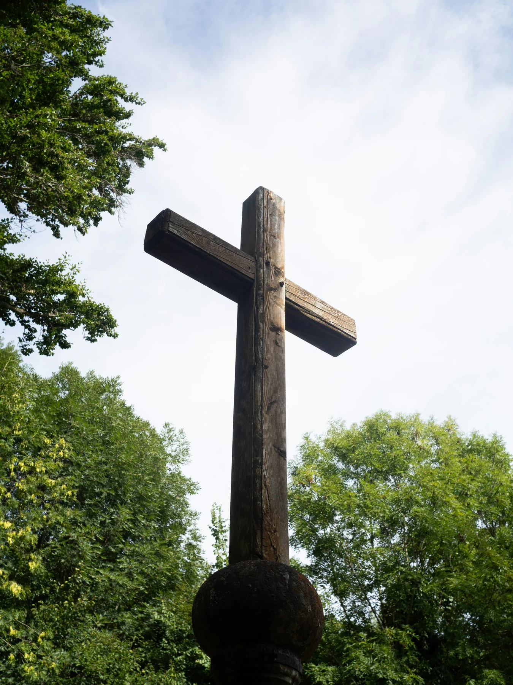

# 해인교회 홈페이지 작업 안내

먼저 `AGENTS.md`를 읽고 따릅니다.

두 AI의 서비스별 인증 상태와 연결 방법은 `docs/AI_COLLABORATION.md`를 확인합니다. 프로젝트 한정 Supabase MCP 설정은 `.mcp.json`에 있으며 별도 OAuth 인증이 필요합니다.

상태·운영 문서는 `docs/PROJECT_STATUS.md`, `docs/OPEN_ISSUES.md`, `docs/OPERATIONS_MANUAL.md`, `docs/BACKUP_VERIFICATION.md`에 있습니다. Astro 변경 전에는 `AGENTS.md`의 공식 가이드를 확인합니다.

- 저장소: `haein-church/haein-church-website`
- 현재 작업 브랜치: `codex/full-onmam-migration`. 기본 브랜치 `master`와 구분해서 확인합니다.
- 로컬 작업 폴더: `C:\Users\icjjokbang\Desktop\해인교회 홈페이지 만드는 중`
- 공유 미리보기: https://codex-preview-20261102.haein-church-9j8.pages.dev/
- Cloudflare Pages: 기존 `haein-church` 프로젝트. 이 미리보기는 `codex-preview-20261102` 브랜치로 수동 업로드합니다.
- Supabase: `haein-church's Org`의 서울 리전 `haein-church-website` (`ambojhrewxsxdavlmkpt`). 다른 계정이나 프로젝트에는 작업하지 않습니다.

## 현재 소스

### 대표 사진 기준본 — 사용자 승인 없이 변경 금지 (2026-11-17)

사용자가 직접 특정 변경을 요청하거나 권한 있는 관리자가 관리자 페이지에서 변경하기 전에는 AI가 대표 슬라이더·사진·성경 문구·순서·표시 여부·디자인을 바꾸면 안 됩니다. 다른 화면, 임의의 사진, 새 생성 이미지로 대체하지 않습니다. 관리자 개선 작업도 대표 사진 변경의 허가가 아닙니다.

같은 작업 브랜치를 fetch한 뒤 아래 **실제 파일**을 열어 사용합니다. GitHub와 Cloudflare에 있는 파일도 이 파일과 같아야 합니다. 기준 커밋은 `a5b5660`, 파일별 SHA-256·크기·슬라이드 내용은 `docs/hero-reference.json`에 있습니다. `node scripts/check_hero_reference.mjs`로 일치 여부를 확인합니다. 이 검사에 맞추려고 기준값을 임의로 갱신하지 않습니다.

1. 요한복음 3:16: `public/images/hero/john-3-16-photo.webp` (1350×1800)
2. 에베소서 4:2–3: `public/images/hero/ephesians-haein-fellowship.webp` (640×480, 해인교회 실제 새가족 환영 사진)

브라우저에서 실제 파일을 받아야 한다면 [십자가 원본 WebP](https://codex-preview-20261102.haein-church-9j8.pages.dev/images/hero/john-3-16-photo.webp)와 [새가족 환영 원본 WebP](https://codex-preview-20261102.haein-church-9j8.pages.dev/images/hero/ephesians-haein-fellowship.webp)를 사용합니다. 캡처 화면을 재사용하거나 다른 사진을 찾지 않습니다. 받은 파일도 위 기준값과 비교합니다.

렌더링은 `src/components/HeroSlider.astro`, 문구와 순서는 `src/data/hero-slides.json`을 그대로 사용합니다. 이 정적 슬라이더를 메인 페이지에서 빼지 않습니다. Claude의 관리자 기능 업데이트(`1abec69`, `68d369e`)는 보존하며, 사진 복구를 이유로 브랜치 전체를 과거 커밋으로 되돌리지 않습니다. 이 규칙은 작업 지침과 빌드 검사이며 AI의 모든 행동을 기술적으로 불가능하게 만드는 권한 체계는 아닙니다.

2026-11-17에 공유 미리보기의 두 사진이 로컬 원본과 SHA-256까지 같음을 확인했습니다. Supabase의 사진 기준 정보 보관 SQL은 로컬 `migration/references/2026-11-17/save-hero-reference.sql`에 준비되어 있습니다. `payload.hero_reference`만 추가하며 기존 메뉴·슬라이드·관리자 설정은 바꾸지 않습니다. 현재 Supabase 커넥터 권한 오류로 원격 저장은 확인 전까지 완료로 간주하지 않습니다. 사진 파일 자체는 무료 저장 정책에 따라 GitHub·Cloudflare Pages에 보관합니다.

- `src/components/HeroSlider.astro`, `src/data/hero-slides.json`: 요한복음 3:16·에베소서 4:2–3 슬라이드. 에베소서 사진은 해인교회가 온맘에 올린 실제 새가족 환영 장면입니다.
- `src/components/SiteNavigation.astro`, `src/layouts/Layout.astro`: 모바일 메뉴·가독성·터치 영역.
- `src/components/ArchiveContent.astro`, `src/data/video-source-links.json`: 미확보 영상 88개에 대응하는 게시글 49개의 Band 원본 연결. 별도 보존된 영상 5개는 직접 열기 링크도 제공합니다. Band 내 실제 재생은 로그인·가입 상태에 따라 확인이 필요합니다.
- `src/pages/admin/site.astro`, `src/lib/online-cms.ts`: 기존 관리자 기능. 기존 관리자 코드를 보존합니다.
- `functions/_middleware.ts`: 숨김 글의 정적 HTML·JSON 접근 보호. 삭제하지 않습니다.

## 원본 자료와 빌드

공개 원본 글 1,987건·안내 페이지 7건을 합쳐 로컬 준비 자료는 1,994건입니다. 원본·첨부·검증 보고서 및 환경변수는 Git에서 제외합니다. GitHub만 새로 내려받으면 모든 원본 데이터가 함께 생기지 않습니다.

- 원본 백업: `migration/onmam/` 및 그 아래 별도 스냅샷
- 준비 데이터: `src/data/onmam.json` (비공개 로컬 파일)
- 첨부: `public/onmam-assets/` (비공개 로컬 파일)
- 검증 기록: `migration/references/2026-11-11/` (비공개 로컬 파일)
- 환경변수: `.env.example`을 참고하고 실제 `.env`는 커밋하지 않습니다.
- 로컬 실행: `pnpm dev` (`127.0.0.1`에만 바인딩)
- 서버는 `astro dev --background`로 실행하고 `astro dev status`, `astro dev logs`, `astro dev stop`으로 관리합니다.
- 빌드: `pnpm build`
- 검증: `pnpm test:cms`, `pnpm test:membership`

공유 미리보기 패키지는 `scripts/prepare_share_preview.mjs --remote-assets`로 준비합니다. 이 모드는 일부 기존 사진·첨부를 온맘 원본 주소로 연결하며, 원본 파일 전체를 새 온라인 저장소에 옮겼다는 뜻은 아닙니다. 원본 백업은 이 컴퓨터에 보존합니다.

변경 소스를 커밋·push한 뒤 같은 커밋으로 Cloudflare 미리보기를 업데이트합니다. 정식 도메인 배포와 자동 배포 재활성화는 별도 사용자 지시가 필요합니다. 온맘 원본을 삭제하지 않습니다.
